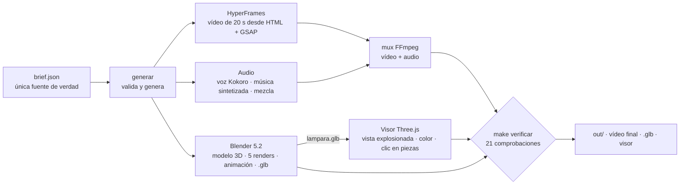

# Estudio creativo de la lámpara

**De un solo archivo (`brief.json`) a un modelo 3D, un visor web interactivo y un vídeo promocional con voz y música, todo generado por código, en local y verificado automáticamente.**

    

Proyecto de aprendizaje y portafolio: un «mini-estudio» creativo que automatiza de punta a punta una pieza de producto (una lámpara de escritorio articulada llamada *Arco*) con **Claude Code** como entorno de trabajo, herramientas abiertas y modelos de IA locales. Está documentado con honestidad: qué funcionó, qué falló, qué no se probó y cuánto cuesta (spoiler: 0 USD fuera de la suscripción a Claude).

| Visor web (Three.js): modelo de Blender frente a primitivas | Fotograma del vídeo (HyperFrames) |
| --- | --- |
|  |  |


## Qué hace

Un único `brief.json` (nombre, lema, beneficios, guion de la voz, paleta, música) alimenta cuatro piezas independientes que se construyen **en paralelo** y se comprueban al final:



- **Reutilizable:** cambiar `brief.json` por otro (hay un segundo producto de prueba, `brief.brasa.json`) regenera todo **sin tocar código**. Lo que el brief no puede cambiar: la geometría de la lámpara, las 5 escenas y los 20 s.
- **Determinista:** el vídeo y los shaders son funciones del tiempo `seek(t)`; la voz usa semilla fija.
- **Verificado:** `make verificar` comprueba el vídeo, el audio (volumen, voz sobre música), el `.glb` y el visor. Las comprobaciones se validaron *rompiendo a propósito* el sistema (mutantes): tres veces una comprobación no comprobaba nada y se arregló.

## Tecnologías

| Área | Herramientas | Para qué |
| --- | --- | --- |
| **Asistente de desarrollo** | Claude Code (Claude Sonnet 5.5, Haiku 5.5), skills, subagentes, hooks | Todo el desarrollo; subagentes por especialidad (`.claude/`) |
| **3D** | Blender 5.2 (`bpy`, `bmesh`), Eevee, glTF/GLB, `mcp-for-blender` (MCP) | Modelo por código, renders, animación, exportación; control en vivo por MCP |
| **Web 3D** | Three.js r186, WebGL2 con shaders GLSL propios, Vite, Vitest | Visor interactivo; un shader de agua en WebGL2 puro |
| **Vídeo** | HyperFrames (HTML + GSAP), Chrome sin ventana + Playwright, FFmpeg | Vídeo como código, renderizado fotograma a fotograma |
| **Voz y audio** | Kokoro-82M (MLX), Whisper large-v3 (MLX), NumPy, FFmpeg (sidechain, `loudnorm`) | Narración local, música sintetizada, mezcla a −16 LUFS, verificación de la voz |
| **IA local** | Ollama, Qwen3.6 27B | Prueba de humo y experimento controlado frente a Sonnet |
| **Orquestación y calidad** | GNU Make (`-j4`), `git worktree`, Python, SQLite, Chart.js | `make studio`, variantes en paralelo, verificador, dashboard de métricas |

Versiones y licencias exactas: [`docs/inventario.md`](docs/inventario.md) y [`THIRD_PARTY.md`](THIRD_PARTY.md).

## Puesta en marcha

**Requisitos:** macOS con Apple Silicon (los modelos de voz usan MLX), [Homebrew](https://brew.sh), Node.js 22 o superior, Google Chrome, y:

```bash
brew install ffmpeg uv
brew install --cask blender   # Blender 5.2
```

```bash
git clone https://github.com/100FOUNTS/estudio-lampara.git
cd estudio-lampara
make setup      # entorno de Python (audio/.venv) y dependencias de Node
make check      # comprueba lo necesario (Ollama es opcional)
make studio     # TODO desde brief.json (con -j4 en paralelo) y termina verificando
```

La primera ejecución descarga de Hugging Face los modelos de voz (Kokoro ≈ 0,4 GB) y de transcripción (Whisper large-v3 ≈ 3 GB).

Otros comandos: `make verificar` · `make variante N=frio B=brief.frio.json` (otra variante en un `git worktree`) · `make help`.

> **Carpeta con ruta corta.** espeak-ng, que usa la voz Kokoro, deja de encontrar sus datos si la ruta supera ≈160 caracteres (en un entorno nuevo falla con `phontab: No such file`). El proyecto debe estar a menos de ≈90 caracteres de profundidad; `make setup` lo comprueba. Detalle en [`docs/diario.md`](docs/diario.md).

## Estructura

```
brief.json · brief.brasa.json     fuente única de datos (y un segundo producto de prueba)
Makefile                          make setup | studio | verificar | variante
plantillas/                       plantilla del vídeo (de ella sale hyperframes/promo/index.html)
scripts/                          generador, verificador (21 comprobaciones), variantes, capturas
blender/                          modelo 3D y animación por código (build_lamp.py)
viewer/                           visor Three.js + pruebas (Vitest) + comprobaciones en Chrome
hyperframes/promo/                vídeo de 20 s (HTML + GSAP)
audio/                            voz, música, mezcla, verificación con Whisper · requirements.txt
video/ · webgl/                   los primeros ejercicios: vídeo con seek(t) y shader WebGL2 puro
experimento/ · experimento-fase7/ comparación controlada de un modelo local frente a Sonnet
dashboard/                        métricas del ejercicio (SQL + Chart.js, todo local)
.claude/                          skill, subagentes y hooks de Claude Code
docs/                             plan, diario, inventario, investigación, retrospectiva
```

## Cómo se construyó (8 fases)

| Fase | Resultado |
| --- | --- |
| 0 | Entorno, `CLAUDE.md`, modelo local con 64K de contexto |
| 1 | Vídeo por código con `seek(t)` |
| 2 | Promo de 20 s con HyperFrames |
| 3 | Visor 3D con Three.js; shader de agua en WebGL2 puro |
| 4 | Lámpara en Blender por script y en vivo por MCP; `.glb` |
| 5 | Voz (Kokoro), música sintetizada, mezcla y verificación con Whisper |
| 6 | `make studio` desde `brief.json`, verificador, skill, subagentes, hooks, variantes |
| 7 | Experimento local frente a Sonnet, retrospectiva y dashboard |

El plan completo, con el porqué de cada paso, está en [`docs/plan-ejercicio.md`](docs/plan-ejercicio.md).

## Resultados medidos

- `make verificar`: **21/21 comprobaciones**; pruebas del visor (Vitest): **18/18**.
- `make studio` en un clon limpio tarda **≈ 30 s** de principio a fin (medido en un Mac M4 Max con 36 GB, con los modelos ya descargados).
- Animación de Blender de 120 fotogramas: 61,5 s en Eevee local.
- Dos productos distintos (Arco y Brasa) salieron del mismo código.
- Coste de herramientas: **0 USD** fuera de la suscripción a Claude.

**Experimento (Fase 7).** La misma tarea, el mismo prompt y el mismo evaluador automático, **un solo intento por modelo**:

| | Qwen3.6 27B (local) | Claude Sonnet 5.5 (nube) |
| --- | --- | --- |
| Requisitos del prompt | 14/14 | 14/14 |
| Calidad no pedida | 1/2 | 2/2 |
| Tiempo | 494 s | 78 s |

Es un solo intento por modelo: sirve para ver diferencias, no es estadística.

## Límites y honestidad

- **No es un producto**: es un ejercicio de aprendizaje. Los minutos del dashboard son estimaciones, no cronometrados.
- **Solo macOS con Apple Silicon** está probado; las rutas de Blender y Chrome están escritas para macOS.
- Los **hooks de Claude Code** son barandillas, no seguridad: solo vigilan Write y Edit, y un comando de Bash puede saltárselos.
- El servidor MCP de Blender **no tiene autenticación**: úsalo solo en `localhost`.
- **No probado:** tareas grandes de varios archivos con el modelo local; Opus 5.5 y GPT-6 Astra no se usaron.
- Los datos de precios y herramientas «a nivel profesional» de `docs/` vienen de fuentes de distinta fiabilidad; cada dato lleva su etiqueta (`[P]` primaria, `[S]` secundaria, `[mío]` conocimiento general).

## Documentación

| Documento | Contenido |
| --- | --- |
| [`docs/plan-ejercicio.md`](docs/plan-ejercicio.md) | El ejercicio paso a paso, con el porqué de cada fase |
| [`docs/diario.md`](docs/diario.md) | Qué falló y qué se aprendió, en orden |
| [`docs/retrospectiva.md`](docs/retrospectiva.md) | Resumen: qué funcionó, errores recurrentes, qué haría ahora |
| [`docs/inventario.md`](docs/inventario.md) | Todo lo usado, con versiones leídas de la máquina |
| [`docs/nivel-profesional.md`](docs/nivel-profesional.md) | Cómo se hace esto a nivel profesional y cuánto cuesta |
| [`docs/linea-pro.md`](docs/linea-pro.md) | La línea de producción etapa por etapa con la herramienta líder de cada una |

## Licencia

Código y documentación bajo licencia [MIT](LICENSE). Los componentes de terceros conservan las suyas: [`THIRD_PARTY.md`](THIRD_PARTY.md).
