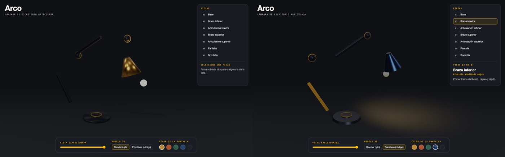
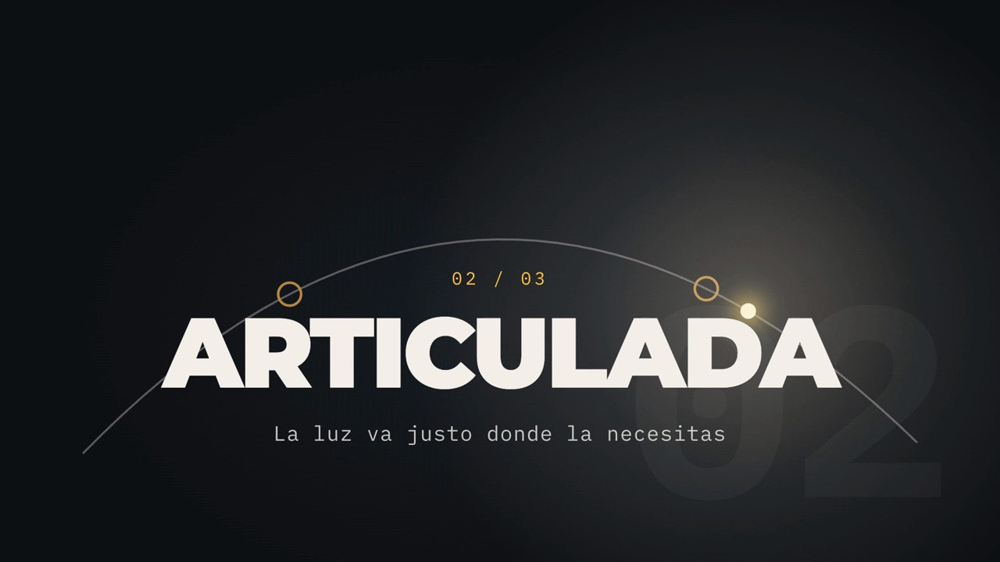
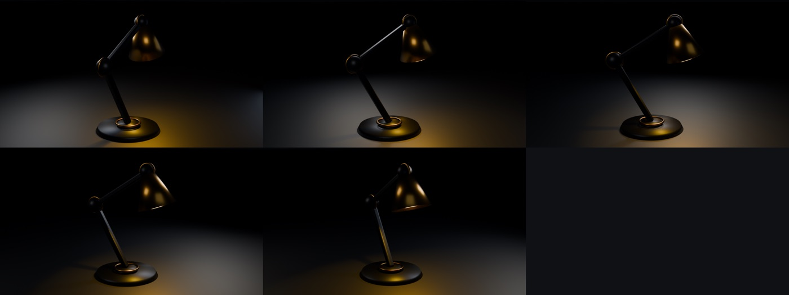
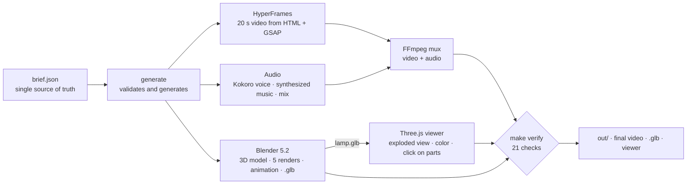

# Brief-to-3D-and-video pipeline

**From a single file (`brief.json`) to a 3D model, an interactive web viewer and a promo video with voice and music, all generated by code, locally, and checked automatically.**

    

A learning project and portfolio piece, written to be used as a **worked example and guide**: a creative mini-studio that automates a product piece end to end (an articulated desk lamp called *Arco*) with **Claude Code** as the working environment, open tools and local AI models. It is documented honestly: what worked, what failed, what was not tested and what it costs (spoiler: 0 USD beyond the Claude subscription).

| Web viewer (Three.js): Blender model versus primitives | Video frame (HyperFrames) |
| --- | --- |
|  |  |



> The images are kept as they were generated: the video content (and the product text in it) is in Spanish, and the viewer screenshot predates the translation of the interface to English.

## What it does

A single `brief.json` (name, tagline, benefits, voice script, palette, music) feeds four independent pieces that are built **in parallel** and checked at the end:



- **Reusable:** swapping `brief.json` for another one (there is a second test product, `brief.brasa.json`) regenerates everything **without touching code**. What the brief cannot change: the lamp geometry, the 5 scenes and the 20 s.
- **Deterministic:** the video and the shaders are functions of time `seek(t)`; the voice uses a fixed seed.
- **Verified:** `make verify` checks the video, the audio (loudness, voice over music), the `.glb` and the viewer. The checks were validated by *breaking the system on purpose* (mutants): three times a check was not checking anything and it was fixed.
- **Language:** the code, the interface and the documentation are in English. The product content (the values in `brief.json`, hence the video text and the narration) is in Spanish; the keys are English, so you can write the content in any language the voice model supports.

## Use it as a template

The lamp is just the example. The pattern is what is reusable:

1. **One brief, many generated outputs.** Put every product decision in one validated file and generate everything else from it (`scripts/generate_from_brief.py`). Generated files are marked and protected by a hook.
2. **Independent pieces, built in parallel, joined at the end** (`Makefile`, `make -j4`).
3. **Everything is a function of time or of the brief**, so results are reproducible (`seek(t)`, fixed seeds, pinned versions).
4. **A verifier that you have tried to fool.** Check the final output, then break the system on purpose and confirm the checks fail (`scripts/verify_output.py`, `docs/journal.md`).
5. **Look at the result.** The `render-check` skill forces contact sheets and measurements instead of "it ran without errors".

To adapt it: copy the repo, replace the values in `brief.json`, and change the product-specific parts: the model in `blender/build_lamp.py`, the parts in `viewer/src/lamp.js`, the scenes in `templates/hyperframes-promo.template.html`. [`docs/exercise-plan.md`](docs/exercise-plan.md) rebuilds it step by step, with the reason for each phase, and [`docs/pro-pipeline.md`](docs/pro-pipeline.md) shows which paid or frontier tool replaces each stage at a professional level.

## Technologies

| Area | Tools | What for |
| --- | --- | --- |
| **Development assistant** | Claude Code (Claude Sonnet 5.5, Haiku 5.5), skills, subagents, hooks | All the development; subagents per specialty (`.claude/`) |
| **3D** | Blender 5.2 (`bpy`, `bmesh`), Eevee, glTF/GLB, `mcp-for-blender` (MCP) | Model with code, renders, animation, export; live control through MCP |
| **Web 3D** | Three.js r186, WebGL2 with own GLSL shaders, Vite, Vitest | Interactive viewer; a water shader in pure WebGL2 |
| **Video** | HyperFrames (HTML + GSAP), headless Chrome + Playwright, FFmpeg | Video as code, rendered frame by frame |
| **Voice and audio** | Kokoro-82M (MLX), Whisper large-v3 (MLX), NumPy, FFmpeg (sidechain, `loudnorm`) | Local narration, synthesized music, mix at −16 LUFS, voice verification |
| **Local AI** | Ollama, Qwen3.6 27B | Smoke test and a controlled experiment against Sonnet |
| **Orchestration and quality** | GNU Make (`-j4`), `git worktree`, Python, SQLite, Chart.js | `make studio`, parallel variants, verifier, metrics dashboard |

Exact versions and licenses: [`docs/inventory.md`](docs/inventory.md) and [`THIRD_PARTY.md`](THIRD_PARTY.md).

## Getting started

**Requirements:** macOS with Apple Silicon (the voice models use MLX), [Homebrew](https://brew.sh), Node.js 22 or higher, Google Chrome, and:

```bash
brew install ffmpeg uv
brew install --cask blender   # Blender 5.2
```

```bash
git clone https://github.com/100FOUNTS/brief-to-3d-video-pipeline.git
cd brief-to-3d-video-pipeline
make setup      # Python environment (audio/.venv) and Node dependencies
make check      # checks what is needed (Ollama is optional)
make studio     # EVERYTHING from brief.json (in parallel with -j4) and ends by verifying
```

The first run downloads the voice model (Kokoro ≈ 0.4 GB) and the transcription model (Whisper large-v3 ≈ 3 GB) from Hugging Face.

Other commands: `make verify` · `make variant N=cool B=brief.cool.json` (another variant in a `git worktree`) · `make help`.

> **Short folder path.** espeak-ng, which the Kokoro voice uses, stops finding its data if the path exceeds ≈160 characters (in a new environment it fails with `phontab: No such file`). The project must be less than ≈90 characters deep; `make setup` checks it. Details in [`docs/journal.md`](docs/journal.md).

## Structure

```
brief.json · brief.brasa.json     single data source (and a second test product)
Makefile                          make setup | studio | verify | variant
templates/                        video template (hyperframes/promo/index.html comes from it)
scripts/                          generator, verifier (21 checks), variants, captures
blender/                          3D model and animation with code (build_lamp.py)
viewer/                           Three.js viewer + tests (Vitest) + checks in Chrome
hyperframes/promo/                20 s video (HTML + GSAP)
audio/                            voice, music, mix, verification with Whisper · requirements.txt
video/ · webgl/                   the first exercises: video with seek(t) and a pure WebGL2 shader
experiment/ · experiment-phase7/  controlled comparison of a local model against Sonnet
dashboard/                        exercise metrics (SQL + Chart.js, all local)
.claude/                          Claude Code skill, subagents and hooks
docs/                             plan, journal, inventory, research, retrospective
```

## How it was built (8 phases)

| Phase | Result |
| --- | --- |
| 0 | Environment, `CLAUDE.md`, local model with 64K of context |
| 1 | Video as code with `seek(t)` |
| 2 | 20 s promo with HyperFrames |
| 3 | 3D viewer with Three.js; water shader in pure WebGL2 |
| 4 | Lamp in Blender by script and live through MCP; `.glb` |
| 5 | Voice (Kokoro), synthesized music, mix and verification with Whisper |
| 6 | `make studio` from `brief.json`, verifier, skill, subagents, hooks, variants |
| 7 | Local experiment against Sonnet, retrospective and dashboard |

The full plan, with the reason for each step, is in [`docs/exercise-plan.md`](docs/exercise-plan.md).

## Measured results

- `make verify`: **21/21 checks**; viewer tests (Vitest): **18/18**.
- `make studio` in a clean clone takes **≈ 30 s** from start to finish (measured on an M4 Max Mac with 36 GB, with the models already downloaded).
- Blender animation of 120 frames: 61.5 s in local Eevee.
- Two different products (Arco and Brasa) came out of the same code.
- Tool cost: **0 USD** beyond the Claude subscription.

**Experiment (Phase 7).** The same task, the same prompt and the same automatic evaluator, **a single attempt per model**:

| | Qwen3.6 27B (local) | Claude Sonnet 5.5 (cloud) |
| --- | --- | --- |
| Prompt requirements | 14/14 | 14/14 |
| Unrequested quality | 1/2 | 2/2 |
| Time | 494 s | 78 s |

It is a single attempt per model: it shows differences, it is not statistics. The prompts and the models' outputs are kept verbatim (in Spanish) in `experiment-phase7/`.

## Limits and honesty

- **It is not a product**: it is a learning exercise. The dashboard minutes are estimates, not timed.
- **Only macOS with Apple Silicon** has been tested; the Blender and Chrome paths are written for macOS.
- The **Claude Code hooks** are guard rails, not security: they only watch Write and Edit, and a Bash command can bypass them.
- Blender's MCP server **has no authentication**: use it only on `localhost`.
- **Not tested:** large multi-file tasks with the local model; Opus 5.5 and GPT-6 Astra were not used.
- The prices and "professional level" tool data in `docs/` come from sources of varying reliability; every figure carries its label (`[P]` primary, `[S]` secondary, `[mine]` general knowledge).

## Documentation

| Document | Contents |
| --- | --- |
| [`docs/exercise-plan.md`](docs/exercise-plan.md) | The exercise step by step, with the reason for each phase |
| [`docs/journal.md`](docs/journal.md) | What failed and what was learned, in order |
| [`docs/retrospective.md`](docs/retrospective.md) | Summary: what worked, recurring mistakes, what I would do now |
| [`docs/inventory.md`](docs/inventory.md) | Everything used, with versions read from the machine |
| [`docs/professional-level.md`](docs/professional-level.md) | How this is done at a professional level and what it costs |
| [`docs/pro-pipeline.md`](docs/pro-pipeline.md) | The production pipeline stage by stage with the leading tool of each |

## License

Code and documentation under the [MIT](LICENSE) license. Third-party components keep their own: [`THIRD_PARTY.md`](THIRD_PARTY.md).
